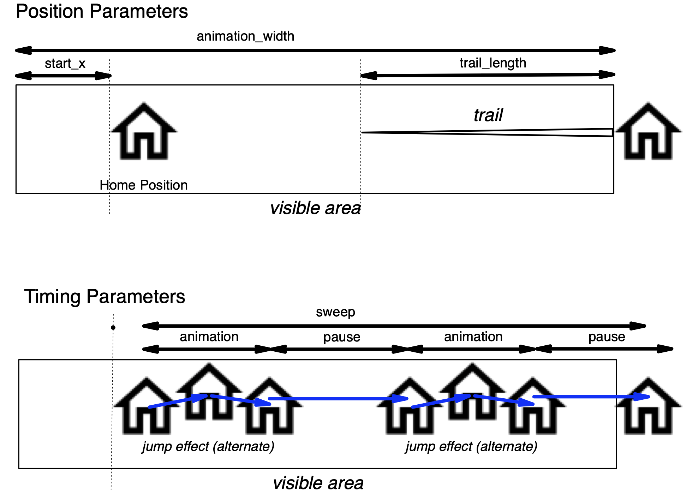

# ESP Icon Sweep

**A configurable icon animation component for ESPHome and LVGL.**

ESP Icon Sweep adds animated icon effects to ESPHome-based displays
using LVGL. Icons move horizontally across the screen, with optional
visual effects such as trails, blinking, scaling, jumping, and
rotation.  

It is designed as an independent component that can be used alongside
ESPHome dashboards and other custom components. 

## Features

- **Horizontal sweep animation** — move icons across the display.
- **Trail effects** — create a fading trail behind moving icons.
- **Configurable animation** — customize the starting position, icon width, and animation duration.
- **Optional effects** — enable blinking, scaling, jumping, and rotation.
- **YAML-based configuration** — configure animations through ESPHome.
- **Multiple icons** — animate different icons independently.
- **LVGL integration** — designed for ESPHome displays using LVGL.

## Requirements

- ESPHome
- An ESPHome-compatible display
- LVGL
- PNG icons or other image assets supported by the configured LVGL image widgets

This component was developed and tested on an ESP32-P4 board with an
800 × 1280 MIPI-DSI display and LVGL 9.5.0. Other configurations may
require additional testing. 

## Installation

Add the component to your ESPHome YAML configuration:

```yaml
external_components:
  - source:
      type: git
      url: https://github.com/Yamawine408/esp_icon_sweep
    components: [esp_icon_sweep]
```

## Configuration

ESP Icon Sweep is configured through ESPHome YAML.

## How It Works

ESP Icon Sweep separates the moving icon from its trail effects.

The icon can move and apply optional transformations while the trail
remains independent. For example, an icon can jump vertically while
its trail continues along a horizontal path.  

This separation allows animation effects to be combined without
requiring the trail to reproduce every movement of the icon. 

## Example

```yaml
  - id: icon_sweep_animation
    widget: icon_sweep_widget
    
    start_x: 40
    animation_width: 800
    home_opacity: 40
    blink_count: 4
    blink_transition: 300ms
    fade_out_transition: 1s
    
    sweep: 30s
    trail_length: 150
    trail_width: 2
    trail_color: 0xFFFFFF
    effects:
      - type: scale
        animation: 200ms
        pause: 10
        alternate: true
        from: 100 
        to: 120
```

In this example, repeating the animation consisting of scaling up from
100\% to 120\% and scaling donw from 120\% to 100\% in 200ms,
followed by 10s pause.
If `alternate` is set to `false`, then only the scale-up takes place in 200ms.



| Name | Type | Default | Description |
| :--: | :--: | :-----: | ----------- |
| `widget` | Widget ID | -- | LVGL widget ID to animate |
| `start_x` | integer | 0 | Horizontal starting position of the animation (pixels) |
| 'animation_width` | integer | 800 | Rightmost X-coordinate reached by the icon's left edge (pixels) |
| `home_opacity` | integer | 25 | Icon opacity at the home position, as a percentage (0–100) |
| `blink_count` | positive integer | 3 | Number of blinks at the home position before the icon starts moving |
| `blink_transition` | time string | 300ms | Duration of one blink cycle |
| `fade_out_transition` | time string | 500ms | Duration of the fade-out animation when stopping |
| `sweep` | time string | 8s | Duration of one complete icon sweep |
| `trail_length` | positive integer | 240 | Length of the trail behind the icon (pixels) |
| `trail_width` | positive integer | 8 | Thickness of trail (pixels) |
| `trail_color` | LVGL color value | 0xFFFFFF | Color of trail |
| `effects` | - | - | List of animation effects to apply while the icon moves |

## Effects

### Common parameters

| Name | Type | Default | Description |
| ---- | :--: | :-----: | ----------- |
| `type` | string | (none) | Effect type (`color`\|`icon`\|`jump`\|`rotate`\|`scale`) |
| `aimation` | time string | 8s | Duration of the effect animation. |
| `pause` | time string | 0 | Pausing time between each animation cycle. |
| `alternate` | boolean | `false` | If `true`, its reverse animation follows. The above `animation` time includes both of forward and reverse animations (if any). |

The default values of the `from` and `to` parameters depend on animation
type.

| animation type | from |  to  | unit |
| :------------: | :--: | :--: | :--: |
| jump           | 0    | 10   | pixel |
| rotate         | 0    | 360  | degree |
| scale          | 100  | 120  | percent |

### `color`

Changing icon color in every second.

```yaml
    effects:
      - type: color
        animation: 3s
        colors:
          - color: 0xFF0000
          - color: 0x00FF00
          - color: 0x0000FF
```

### `icon`

Alternate icons.

```yaml
    effects:
      - type: icon
        animation: 10s
        icons:
          - image: icon1
          - image: icon2
```

### `jump`

Jump icon 2 times in 200ms with the jump height of 5 pixels, followed
by 10 seconds pause.

```yaml
    effects:
      - type: jump
        pause: 10s
        animation: 200ms
        alternate: true
        height: 5
        bounces: 2
```

### `rotate`

Rotating the icon without stopping the rotation. Its rotation speed is
1 round per second in this example.

```yaml
    effects:
      - type: rotate
        animation: 1s
        from: 0
        to: 360
```

For vibration (small back-and-forth rotations), use angles around the
desired resting position rather than crossing the 0/360 degree boundary. 
For example, to gently wobble an icon by 10 degrees in either direction:

```yaml
- type: rotate
  animation: 1s
  from: -10
  to: 10
  alternate: true
```

Specifying the rotation direction can be a little tricky. Let's call
the change in rotation angle during each LVGL animation loop &Delta;.
In the example above, `from` is -10 and `to` is 10. Since the `from`
value is smaller than the `to` value, &Delta; is positive. For
simplicity, let's assume the absolute value of &Delta; is 10. The
rotation angle then changes from -10 to 0 and then 10. If the values
are swapped, &Delta; becomes negative, and the angle changes from 10
to 0 and then to -10. Therefore, setting `from: 0` and `to: 360` makes the
icon rotate clockwise, while setting `from: 360` and `to: 0` makes it
rotate counterclockwise. 

### `scale`

In this example, the icon scales from 100% to 120% of its original
size. 

```yaml
    effects:
      - type: scale
        pause: 10s
        animation: 3s
        from: 100
        to: 120
```

### Effect Combinations

Multiple effects may be combined, but some combinations will not behave
as expected. In particular, effects that modify the same property may
interfere with each other. Use such combinations with care.

## How to Start/Stop Animation

Here is the sample YAML code to start and stop animatiom.

```yaml
platform: homeassistant
id: icon_sweep_trigger
entity_id: input_boolean.show_alert
internal: true
trigger_on_initial_state: true

on_state:
  then:
    - if:
        condition:
          binary_sensor.is_on: icon_sweep_trigger
        then:
          - lambda: id(icon_sweep_widget_id).start();
        else:
          - lambda: id(icon_sweep_widget_id).stop();
```

## License

This project is distributed under the license included in the
repository. See [LICENSE](LICENSE) for details. 

## Contributing

Issues, suggestions, and improvements are welcome. Please include your
ESPHome version, LVGL version, display configuration, and relevant
logs when reporting problems. 

